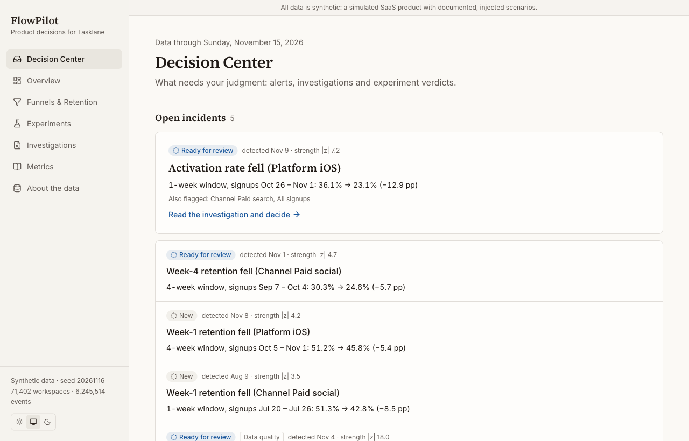
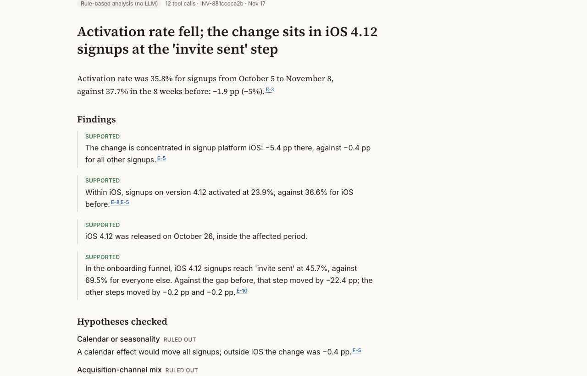
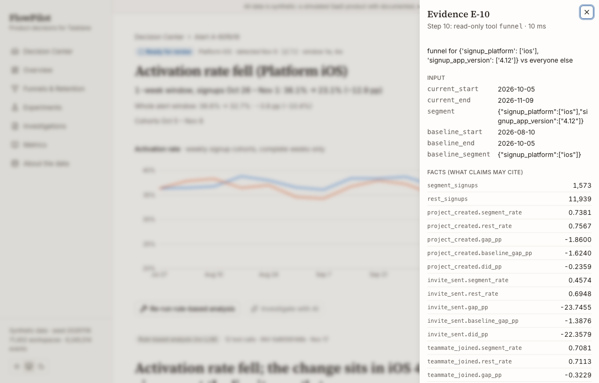
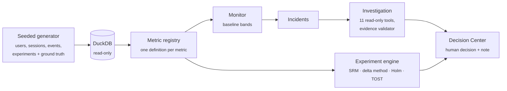

# FlowPilot

> **Product analytics and decision support with verifiable evidence.** When a product metric drops, FlowPilot finds where it broke and shows the evidence behind every number. It also stops experiment "wins" that would not hold up.

[](https://github.com/janpaulreckling/flowpilot/actions/workflows/ci.yml)


[](https://janpaulreckling.github.io/flowpilot/)

**[Open the live demo](https://janpaulreckling.github.io/flowpilot/)**: a static snapshot of a real run. No login needed. Short on time? Read the **[case study](https://janpaulreckling.github.io/flowpilot/case-study)** (5 minutes).



Personas, jobs to be done and the demo journey are in the [product brief](docs/PRODUCT_BRIEF.md).

All data is **synthetic**: a simulated team task-management product called *Tasklane*, with injected, documented problems ([DATA_SCENARIOS.md](docs/DATA_SCENARIOS.md)). That is deliberate. Because the true causes are known, every result below can be checked against them.

## Why it matters

"Why did activation drop last week?" usually means a day of slicing dashboards. Is it real or noise? Which segment? Which step? Is it seasonality, or did the channel mix change? Meanwhile an A/B test that "won" at p < 0.05 gets shipped even though it quietly hurt retention, or its traffic split was broken.

| Without it | With FlowPilot |
|---|---|
| Someone notices a dip in a dashboard, eventually | A monitor checks the key metrics, their segments and two time windows against their own baselines. It alerts only above a statistical **and** a practical threshold. |
| Several alerts for one problem (overall, iOS, paid search) | Grouped into one incident, led by the strongest signal |
| The investigation lives in someone's notebook | A written report: where the change sits, which explanations were ruled out, what to do. Every number links to the query that produced it. |
| "The test won, ship it" | Sample-ratio check first, a guardrail can veto the launch, "no meaningful effect" is a real verdict, and nothing is decided before the planned end date. |
| Decisions in Slack | Approve, reject or "need more evidence", each with a required note, stored next to the evidence |

## What it found in the data

The headline incident is an iOS release (4.12, Oct 26) that broke the "invite a teammate" step:

- The monitor flagged it on the first day the data could show it. Activation is measured over 7 days, so that is the day after the first full post-release cohort week matured (Nov 9).
- In the 1-week window, iOS activation fell from 36.1% to 23.1% (**−12.9 pp**).
- Without being told any of this, the investigation then:
  - localized the drop to **iOS 4.12** (a significance test on the segment, not its size);
  - found the step: at "invite sent", iOS 4.12 converts at 45.7% against 69.5% for everyone else, which is **−22.4 pp** against the gap before the release, while the other steps moved by less than 0.3 pp;
  - ruled out seasonality (other platforms moved −0.4 pp) and the channel mix (+0.0 pp of the change);
  - recommended a fix plus a cohort check instead of an experiment.



Every footnote opens the tool call behind it: inputs, every returned fact, and a SHA-256 of the output. A validator rejects any report whose numbers do not match the cited facts, in order and with the right sign.



## Measured results

All numbers come from the default synthetic dataset (seed 20261116: 71,402 workspaces, 163,474 users, 6.2M events). They are scored against the injected ground truth, not against real customers.

| | Result |
|---|---|
| **Monitor** (back-test over 28 weeks, 4,624 tests) | All 3 monitorable scenarios caught: iOS activation regression, paid-social retention drop, Android tracking gap. 7 decline alerts: 5 explained by the scenarios (1 of them partially), 1 partially by experiment E3's treatment, **1 false alarm**. The run reports 0.9 chance crossings expected. |
| **Data quality** | The Android tracking gap was flagged as "tracking gap or functional break" (events per session −100% on app version 7.3, sessions normal), not as a drop in usage. |
| **Experiments** (4 in the data) | 4 of 4 verdicts match the ground truth: **ship** (+3.4 pp activation); **no meaningful effect** (equivalence test); **don't ship** (trial-to-paid up, but week-2 retention −2.2 pp breaches a guardrail); **invalid** (sample ratio 46.7/53.3, SRM p ≈ 1e-11). |
| **Rule-based investigator** (every decline alert) | 6 of 7 on the default seed, **9 of 16 on three new seeds** (2 of 8 for the iOS regression). The rules were revised on the default seed and generalize worse; the main cause is a too-strict seasonality rule ([EVALUATION.md](docs/EVALUATION.md)). |
| **Statistics checks** | Over 2,000 A/A simulations, the 95% interval's coverage falls inside the tested 93.5–96.5% band, including with clustered users. A naive per-user interval covers less than 85%. |

The rules were committed before each component first ran: the monitor, the experiment analysis and the investigator. A structured method review later found weaknesses. The fixes were committed as a documented **v2** with v1 and v2 results side by side ([METHOD_V2.md](docs/METHOD_V2.md)), and the git history shows the order.

## How it works



### Analyst decisions that matter

The full list is in [DECISIONS.md](docs/DECISIONS.md).

**Metric definitions**
- **"Active" means a core action**, not an app open (D25).
- **Retention week N is bracketed:** days 7N to 7N+6, so the curve shows when users drop off (D26).
- **Incomplete periods are never compared** with complete ones, and an empty segment is "undefined", not 0.

**Experiments**
- **The randomization unit is the workspace** (teammates share a product), analyzed as intent-to-treat with delta-method variance.
- **SRM blocks a verdict.** Guardrails are Holm-corrected and must stay within 1 pp, and "ship" needs the 95% interval above zero.

**Process**
- **Rules before results:** monitor thresholds and experiment rules were committed before their first run. Seeds were never picked to get a "right" answer; the data volume was chosen from a power calculation instead (D20).

## The AI agent: built and tested, not yet measured

FlowPilot includes an LLM investigation agent: a hand-written tool-use loop on the Claude API (D4).
- **Tools:** the same 11 read-only tools as the rule-based investigator. No free SQL, and no user-generated text reaches the model.
- **Evidence:** reports go through the evidence validator; rejected numbers are sent back with the reason.
- **Hard caps:** steps, tool calls, tokens, US$ per run and time. Each cap ends the run with a named failure state.

It is tested end to end with a scripted model: a corrected hallucination, a refused write attempt, every limit, refusals and API errors. **It has not been run against a real model yet**, so there is no measured quality or cost to report. The demo shows rule-based investigations, labeled as such. Measuring real runs with the same scorer is the first roadmap item.

## Quickstart

```bash
uv sync                 # Python 3.12
make data               # simulate the dataset, build the store, run the monitor (~15 s)
make serve              # API on http://localhost:8000
cd frontend && npm ci && npm run dev   # UI on http://localhost:5173
```

Optional: `ANTHROPIC_API_KEY=... make serve` enables "Investigate with AI".

## Testing

```bash
make check      # ruff, mypy --strict, 126 pytest tests (~15 s, generates its own data)
make ui-check   # TypeScript, lint, 7 component tests, production build
make demo       # export the static demo and run the Playwright journey (desktop + phone)
```

The tests:
- compare every metric against an independent pure-Python reference built from the raw files;
- check each injected scenario with tolerance bands;
- run A/A simulations;
- feed hallucinated, swapped and sign-flipped numbers to the validator;
- probe the API with huge ranges, cross-site writes and concurrent runs.

CI runs all of it on every push.

## Project layout

```text
src/flowpilot/
  generator/      seeded simulation of Tasklane + ground truth
  warehouse/      DuckDB schema, derived tables, read-only connection
  metrics/        YAML registry and the engine that compiles it to SQL
  monitor/        anomaly detection
  experiments/    statistics and the decision rules
  investigation/  read-only tools, evidence log + validator, rule-based investigator, LLM agent
  evaluation/     scoring against the ground truth (the product code never imports it)
  appstate/       alerts, incidents, investigations, decisions (SQLite)
  api/            FastAPI
frontend/         React + TypeScript + Tailwind + Recharts, Playwright journey in e2e/
docs/             metrics, monitoring, experiments, investigations, method v2, limitations
```

## If you are hiring for

- **Product / growth analytics:** [METRICS.md](docs/METRICS.md), [EXPERIMENTS.md](docs/EXPERIMENTS.md), and the Experiments page in the demo.
- **Business systems / technical BA:** [DECISIONS.md](docs/DECISIONS.md), [MONITORING.md](docs/MONITORING.md) and the Decision Center workflow.
- **AI automation:** [AGENT.md](docs/AGENT.md), `src/flowpilot/investigation/` and `tests/test_llm_agent.py`.

## Limitations and roadmap

Known weaknesses are listed in [KNOWN_LIMITATIONS.md](docs/KNOWN_LIMITATIONS.md), among them a count monitor that lags growth (58 improvement notices) and detection limited by metric windows.

Next:
1. Measure the LLM agent on the same 16 new-seed alerts with the same scorer ([EVALUATION.md](docs/EVALUATION.md)): pass rate, validator rejections, cost per run.
2. A rule-based investigator that generalizes: a noise-aware seasonality test instead of the fixed 1 pp rule. It would be evaluated on further unseen seeds.
3. Release-aware monitoring (invite rate per app version from day 1) to catch regressions like S1 faster.
4. A growth- and seasonality-aware baseline for count metrics, to cut the improvement notices. It would ship as a new version evaluated on unseen data, not as a re-tune of the current monitor.
5. Per-metric guardrail margins, chosen when an experiment is planned (for new experiments, not re-applied to finished ones).
6. Sequential testing and variance reduction (CUPED) for experiments.

## Related

Part of a portfolio set in different business domains:
- [order-to-cash-sync](https://github.com/janpaulreckling/order-to-cash-sync): Salesforce to ERP integration.
- [cash-reconciliation-engine](https://github.com/janpaulreckling/cash-reconciliation-engine): payment matching and month-end controls.
